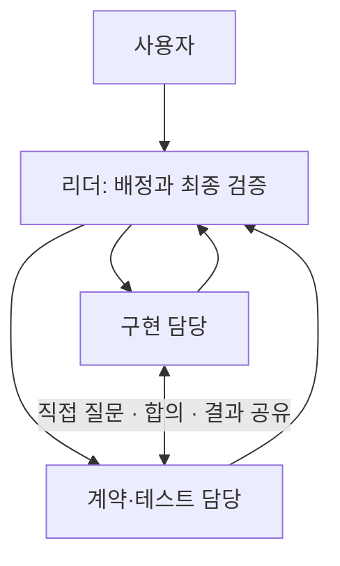

# Multi Agent v2

**에이전트끼리 직접 질문하고 조율하며 업무를 끝내는 Codex 스킬입니다.**

리더가 업무를 나누면 담당 에이전트들이 API나 파일 형식을 직접 합의하고, 구현 결과와 테스트 결과를 서로 전달합니다. 리더는 전체 진행을 관리하고 최종 결과를 통합·검증합니다.

이 저장소의 `v2`는 스킬 이름입니다. 스킬 설치가 Codex의 런타임 기능을 새로 추가하거나 특정 버전을 활성화하지는 않습니다. 직접 메시지를 지원하는 협업 도구가 필요합니다.



## 빠른 시작

준비물은 Git과 로그인된 Codex입니다. 예제를 실행할 때는 Python 3.10 이상도 필요합니다. Python 예제에는 추가 패키지가 필요 없습니다.

```bash
git clone https://github.com/nowcika/multi-agent-v2.git
cd multi-agent-v2
mkdir -p "$HOME/.agents/skills"
cp -R skills/multi-agent-v2 "$HOME/.agents/skills/"
```

같은 이름의 스킬이 이미 있다면 먼저 기존 내용을 확인하세요. 복사 설치는 저장소를 업데이트해도 자동 갱신되지 않습니다. 업데이트 시 같은 경로에 다시 복사하면 됩니다.

Codex에서 `/skills` 또는 `$` 선택기로 스킬을 확인합니다. 보이지 않으면 새 세션을 시작합니다. 개인 스킬 경로와 호출 방식은 [공식 스킬 문서](https://learn.chatgpt.com/docs/build-skills)를 기준으로 작성했습니다.

원하는 프로젝트에서 Codex를 실행한 뒤 다음처럼 요청합니다.

```text
$multi-agent-v2 로그인 기능을 구현해 줘.
구현 담당과 테스트 담당이 직접 API 계약을 합의하고,
파일 수정 담당을 나눠 작업한 다음 전체 테스트를 실행해 줘.
```

환경 설정과 Linux 오류 해결은 [환경 설정 가이드](docs/setup.md)를 참고하세요.

## 어떻게 협업하나요?

| 역할 | 하는 일 |
| --- | --- |
| 리더 | 요구사항 정리, 담당 배정, 실제 동료 주소 전달, 장애 해소, 결과 통합 |
| 담당 에이전트 | 맡은 산출물 작성, 관련 동료에게 직접 질문·회신, 결과 인계 |
| 검증 담당 | 합의한 계약으로 독립 검증, 문제를 구현 담당에게 직접 전달 |

예를 들어 구현 담당이 “금액 합계를 문자열로 반환하겠다”고 제안하면 테스트 담당이 이를 확인하고 기대값을 정합니다. 구현이 끝나면 테스트 담당에게 직접 검증을 요청합니다. 수정할 문제가 있으면 두 담당자가 조율합니다.

`send_message`는 메시지를 전달하는 도구이고, 완료된 에이전트의 작업을 다시 시작할 때는 리더가 `followup_task`를 사용합니다. 이 차이를 스킬에 명시했습니다. 파일별 수정 담당도 나눠 공유 폴더에서 덮어쓰는 일을 방지합니다.

## 테스트 예제

실제로 두 에이전트가 함께 만든 CSV 금액 합계 프로그램과 독립 테스트가 들어 있습니다.

```bash
python3 examples/csv-totals/totals.py examples/csv-totals/sample.csv
# {"total": "10.55"}

python3 -m unittest discover -s examples/csv-totals -p 'test_*.py' -v
# Ran 9 tests ... OK
```

Python 테스트는 예제 프로그램의 정확성을 검사합니다. 에이전트를 생성하거나 메시지를 보내는 테스트는 아닙니다. 실제 협업을 다시 시험하려면 [협업 재현 시나리오](docs/testing.md)를 사용하세요. 당시의 [실행 검증 보고서](reports/multi-agent-v2-test.md)도 함께 제공합니다.

## 다른 업무에 쓰기

```text
$multi-agent-v2 이 저장소의 버그를 조사하고 수정해 줘.
원인 조사 담당과 구현·검증 담당이 발견 사항을 직접 공유해 줘.
```

```text
$multi-agent-v2 API 서버와 프런트엔드를 함께 구현해 줘.
각 담당자가 요청·응답 형식을 직접 합의하고 계약 변경을 서로 알려 줘.
```

작은 업무는 리더가 직접 처리할 수 있습니다. 에이전트 수가 많아질수록 토큰 사용량과 조율 비용이 늘어나므로 필요한 최소 인원으로 시작합니다. [공식 서브에이전트 문서](https://learn.chatgpt.com/docs/agent-configuration/subagents)도 참고하세요.

## 파일 구성

```text
skills/multi-agent-v2/       설치할 스킬과 UI 메타데이터
examples/csv-totals/         실제 구현 결과와 Python 테스트
docs/setup.md               환경 설정과 문제 해결
docs/testing.md             실제 협업 재현 방법과 판정 기준
reports/                    최초 협업 검증 기록
.github/workflows/tests.yml 예제 프로그램 자동 테스트
```

검증 환경은 Ubuntu 24.04, Codex CLI 0.162.1과 이 세션의 `collaboration` 도구입니다. 다른 클라이언트의 도구 이름·지원 범위는 달라질 수 있습니다. 대규모 협업, 충돌 복구, 자동 스킬 검색은 최초 시험 범위에 포함되지 않았습니다.
